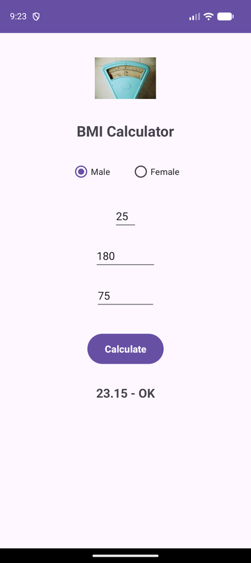
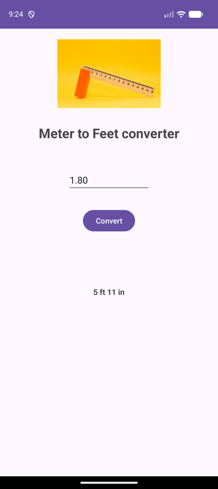
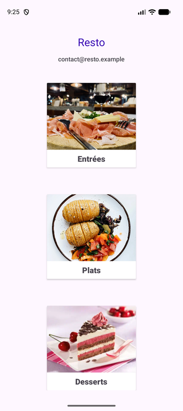
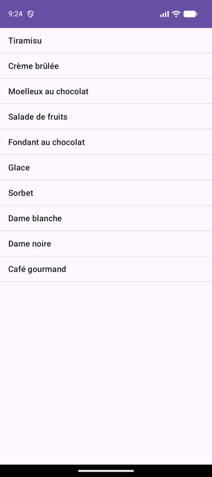
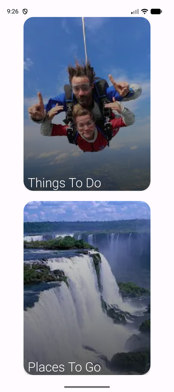
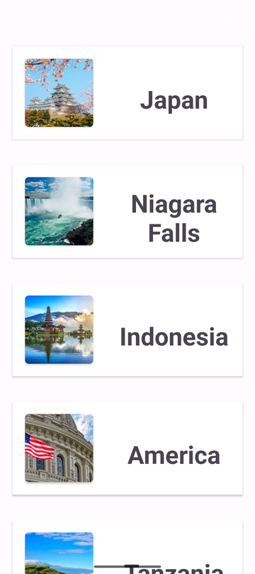
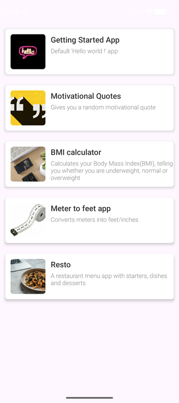
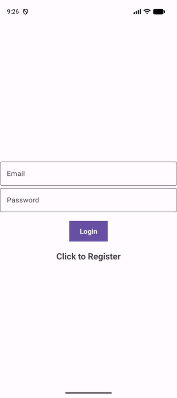

# Android Studio Projects

The small Android apps I built while learning native Android development in **Java** with Android Studio.
Each folder is a standalone Gradle project that you can open directly in Android Studio.

| App | What it does | Concepts practiced |
|---|---|---|
| [**BMI Calculator**](BMICalculator) | Computes your Body Mass Index from height and weight and tells you whether it is in the healthy range (adults), or points minors to their doctor. | Form input, input validation, radio buttons, number formatting |
| [**Meter to Feet Converter**](MeterToFeetConverter) | Converts a distance in meters to feet and inches. | `EditText` parsing, error handling, unit conversion |
| [**Resto**](Resto) | A restaurant menu app with three sections (starters, main courses, desserts) and a tappable contact e-mail. | Multiple activities, explicit & implicit `Intent`s, `CardView`, `ListView` + `ArrayAdapter` |
| [**Bucket List**](BucketList) | Two illustrated lists: things I want to do and places I want to visit. | `CardView`, `RecyclerView`, custom `Adapter` / `ViewHolder`, inheritance |
| [**Portfolio**](Portfolio) | An in-app portfolio listing my other Android projects with an icon and a description. | `RecyclerView`, custom `Adapter` / `ViewHolder`, data model class |
| [**Firebase Login**](FirebaseLogin) | Sign-up, login and logout screens backed by Firebase Authentication (e-mail & password). | Firebase Auth, async callbacks, session handling, navigation between screens |

## Screenshots

| BMI Calculator | Meter to Feet Converter | Resto | Resto: desserts |
|---|---|---|---|
|  |  |  |  |

| Bucket List | Bucket List: places | Portfolio | Firebase Login |
|---|---|---|---|
|  |  |  |  |

## Tech stack

- Java, Android SDK (min SDK 24, 35 for Bucket List)
- XML layouts, Material Components, ConstraintLayout
- Gradle (Kotlin DSL)
- Firebase Authentication (Firebase Login app)

## Running a project

1. Clone the repository:
   ```bash
   git clone https://github.com/sasam007/android-studio-projects.git
   ```
2. In Android Studio, choose **File → Open** and select one of the app folders (e.g. `Resto`), not the repository root.
3. Let Gradle sync, then run the app on an emulator or a device.

### Firebase Login setup

The Firebase configuration file is not committed. To run this app, create a Firebase project, enable
**Email/Password** sign-in under *Authentication*, register an Android app with the package name
`com.example.myapplication`, and put the downloaded `google-services.json` in `FirebaseLogin/app/`.
